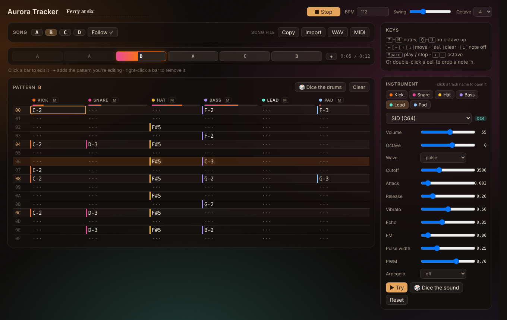

# Aurora Tracker

A small, fun tracker for making music in Obsidian. Six synth tracks, drums built from noise and FM, a C64-style SID mode, and songs that are plain text in your notes.



## Making a song

Run **Aurora Tracker: New song** (or click the waveform icon in the ribbon). A new note opens in the tracker. To hear what it can do first, run **Aurora Tracker: Open the demo song**.

- **Six tracks:** Kick, Snare, Hat, Bass, Lead and Pad.
- **Patterns** A to D, each 16 rows. The **pattern sequencer** plays them in order: click a bar to edit it, **+** adds the pattern you're editing, right-click removes one. While it plays, the bar fills and played bars fade.
- **Notes from the keyboard**, the tracker way:

| Keys | What they do |
|---|---|
| `Z`–`M` | notes (`Q`–`U` an octave up) |
| `1` | note off |
| `Del` | clear |
| arrows | move |
| `Space` | play / stop |
| `+` / `−` | octave |

  Or double-click a cell to drop a note in.
- **🎲 Dice the drums** rolls a new groove for the pattern.
- BPM, swing, mute per track, and level meters that move with the music.

## Sounds

Click a track's name to open its instrument: pick a preset, then shape it with the knobs. **▶ Try** plays it, **🎲 Dice the sound** rolls a variation, and **Reset** goes back to the preset.

| Track | Presets |
|---|---|
| Kick | Boom (808), Punch, Lo-fi, SID |
| Snare | Snare, Clap, Rim, SID |
| Hat | Closed, Shaker, Ride, SID |
| Bass | Saw, Sub, FM, Acid, SID |
| Lead | Square, Pluck, FM bell, Chip (8-bit), SID |
| Pad | Warm, Glass, Choir, SID |

Everything is synthesis, with no samples:

- **Drums** mix noise and FM. F# and G# on the hat track give an open hat.
- **SID presets** borrow the Commodore 64's character: the pulse wave with a moving width, and lightning-fast arpeggios at the C64's 50 steps a second.
- **Octave** shifts a whole track up or down.

## Songs are text

A song is a `tracker` block in a note:

````
```tracker
title: Ferry at six
bpm: 112
order: A A B A C B
sound lead: sid wave=pulse cutoff=3500 pw=0.25 pwm=0.7 arp=off

pattern A
00 | C-2 ··· F#5 A-2 ··· A-3
01 | ··· ··· F#5 ··· ··· ···
```
````

- **Play it in place:** in reading view the block becomes a small player, with a play button, the song's patterns and **Edit**.
- **Share it as text:** **Copy** puts the song on your clipboard to paste anywhere, and **Import** turns pasted text back into a song. The sounds come with it.
- **Export audio:** **WAV** renders the whole song and **MIDI** writes it for any DAW. Both save into your vault, next to the song or in a folder you choose.

## Works with

- **The AshOtis players** (Static FM, Hi-Fi Tuner, Aurora MP3): one plays at a time, unless you turn on **Play alongside other players**.
- **[Static Aurora](https://github.com/AshOtis/aurora-theme):** while a song plays, the theme glows in the tracker's colours. The aurora behind the editor pulses with the kick (you can turn both off).

## Settings

- **Songs folder** and **exports folder**
- **Play alongside other players**
- **Colour the Static Aurora theme**
- **Aurora background**, with Glow and Darken

## Privacy and network

Aurora Tracker makes no network requests. It reads and writes only the song notes you open with it, and saves WAV and MIDI files only when you export.

## Support

If it makes you smile, you can [buy me a coffee](https://buymeacoffee.com/ashotis). Bugs and ideas: [issues](https://github.com/AshOtis/Aurora-Tracker/issues).

[GNU AGPL v3 or later](LICENSE) © AshOtis
